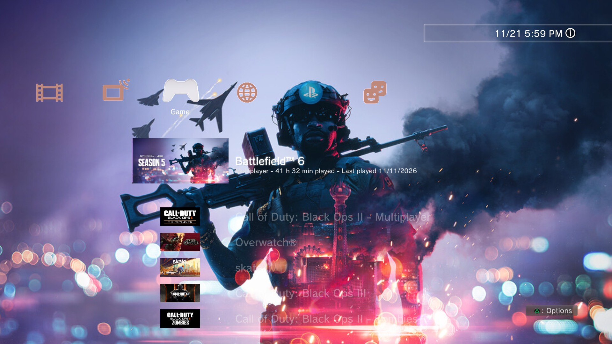
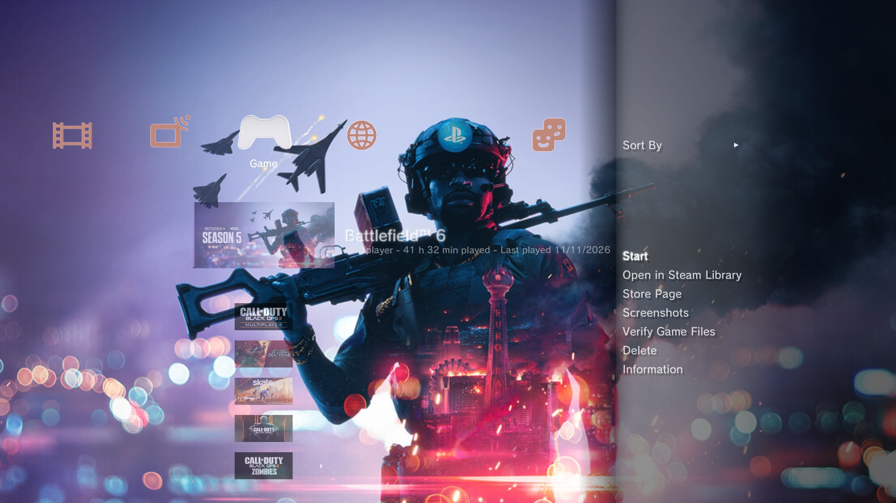
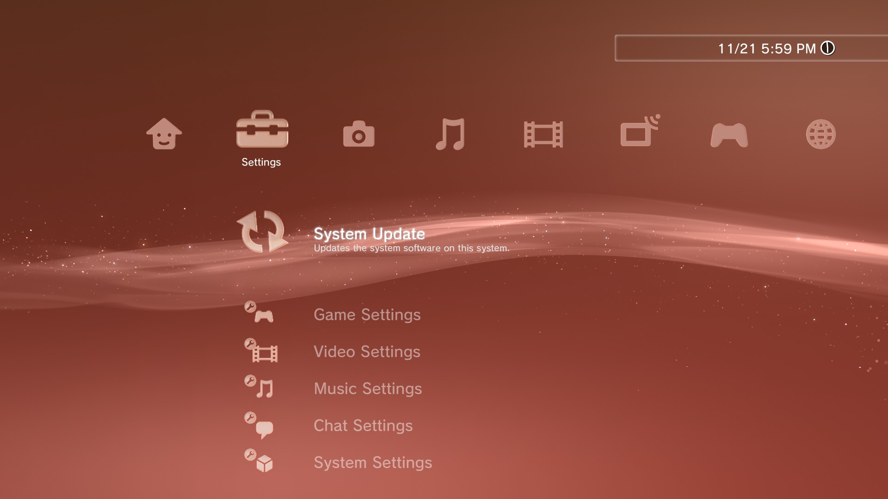
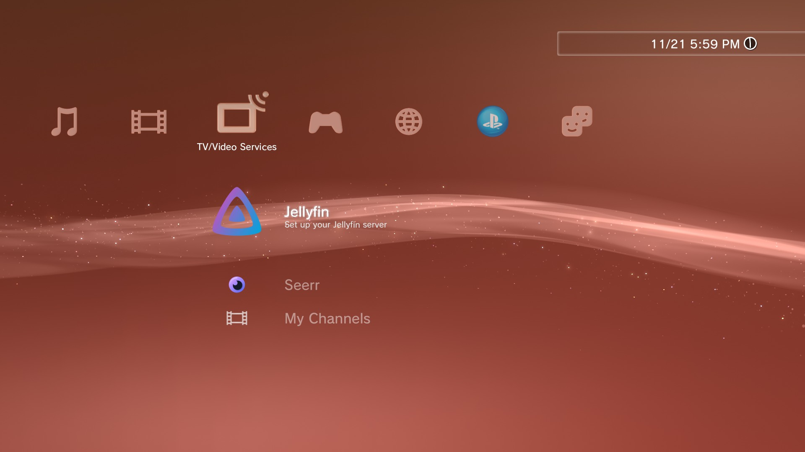
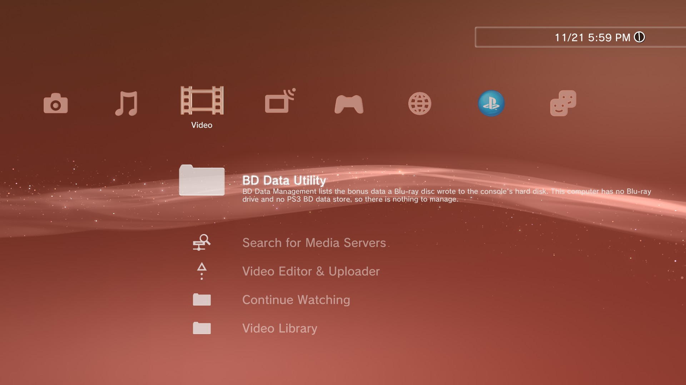
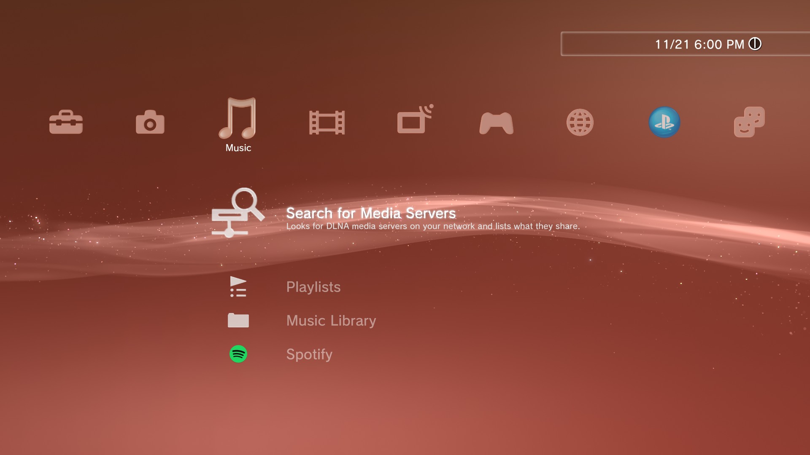
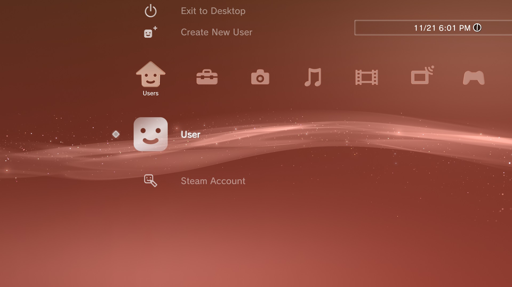

# XMB-Rewritten: a native PS3 XMB for Windows



A native C++20 / Qt 6 recreation of the PlayStation 3 **4.93 XMB**, built as a living-room PC (HTPC) front end. It draws the console's own interface from the firmware's assets, which it reads from your own copy of the PS3 system software, and reproduces its look, motion, sounds and navigation. It is **not affiliated with Sony**, and **no Sony firmware or assets are in this repository**.

One CMake project builds two programs:

| Program | What it is | Docs |
|---|---|---|
| `re-ps3-native.exe` | The XMB: category bar, item columns, pages, options menus, dialogs, settings, media players, the on-screen keyboard, the system menu, themes and the cold-boot intro | [native-xmb/README.md](native-xmb/README.md), [INSTALL.md](native-xmb/INSTALL.md) |
| `xmb-manager.exe` | A companion that detects emulators and imports ROMs, ISOs and game folders as PS3-style packages for the Game column | [MANAGER.md](native-xmb/MANAGER.md) |

## Screenshots

<!-- Captures: real, unmodified native renders at 1920x1080, taken with the app's own
     `--script ... grab=...` framebuffer capture against the local 4.93 dev_flash and this
     machine's real Steam library (installed titles and their Steam artwork). No AI generation
     and no mockups. The repository copies are JPEG; provenance is in
     [native-xmb/SCREENSHOTS.md](native-xmb/SCREENSHOTS.md). -->

| | |
|---|---|
|  |  |
| The Options (Triangle) menu on a Steam title | Settings column |
|  |  |
| TV/Video Services, with the Jellyfin setup row | Video column |
|  |  |
| Music column | Users column |

The screenshots show the firmware's icons, fonts and artwork, because that is what the XMB draws. The Game column at
the top is this machine's actually installed Steam titles — with their Steam artwork and Steam's collection labels —
rather than fictional fixtures. More notes on captures are in [SCREENSHOTS.md](native-xmb/SCREENSHOTS.md).

## What it does

- **The XMB shell:** category navigation, a page stack with selection restore, the Options menu, message boxes, settings pages, the system menu, themes (`.p3t`), the 4.93 cold-boot intro and the traced interaction sounds.
- **Local media:** the video player follows the console's own player resources (the Triangle menu is the console's control matrix, with this build's extras in a Native Extras panel after it), video with sidecar subtitles and resume, a music player with a visualizer, photo viewing and the 3D Photo Gallery, and playlists. Folder and file pickers are drawn inside the XMB, so a controller can drive them.
- **Streaming and content:**
  - **Jellyfin:** set up from inside the XMB (server address, a server check and an optional LAN search), libraries and folders, direct play and HLS transcodes, subtitles, a remembered sign-in, and a Music-column entry that reuses it (artists, albums, playlists, songs, favourites, lyrics). Playback reports progress to the server, resumes from its position, offers Next Up and Up Next, chapters, audio and subtitle choice, and watched and favourite marks.
  - **Steam:** installed titles in the Game column, collections, the store, downloads, accounts, and Quit Game that closes the game's own processes.
  - **Spotify**, **DLNA / UPnP** discovery and **RAWG** artwork.
- **Home and network:** Tailscale, Wake on LAN, Home Assistant and weather, each as a native page.
- **System:** Restart, Sleep and Shut Down, audio output switching, a read-only System Check and user management.
- **Input:** keyboard, XInput pads (Guide is the PS button), DualShock 3, DualShock 4 and DualSense over HID (USB or Bluetooth), IR and Bluetooth remotes and media keys. `Ctrl+V` and `Shift+Insert` paste into the on-screen keyboard, and the keyboard also has a Paste key for a pad.
- **Living-room operation:** kiosk mode, a crash watchdog with a safe mode, start at sign-in, an in-game system menu over a running title, and web apps in a tracked window that returns to the XMB when closed.
- **Display scaling:** the 1920x1080 design is scaled to any window size and Windows display scale, at the screen's real pixel resolution, with black bars when the screen is not 16:9. See [HIGH-DPI.md](native-xmb/audit/HIGH-DPI.md).

## Get started on a TV PC

You need Windows 10 or 11 (x64). The XMB reads your own PS3 4.93 `dev_flash`, which it can download from Sony for you.

1. Download `re-ps3-setup.exe` from the [latest release](https://github.com/ajgreenboy/XMB-Rewritten/releases/latest). The installer is not code-signed, so Windows SmartScreen will warn. Choose More info, then Run anyway.
2. On the installer's Firmware page leave **Download from Sony now** selected. The installer fetches Sony's 4.93 system software (about 200 MB), checks every entry in it and unpacks it into the XMB's data folder. You can instead point it at a `dev_flash` you already have.
3. Pick the display number. A single screen is 0. With a monitor and a TV, the TV is usually 1.
4. Start the XMB. The first-run setup walks through firmware, library folders, controller and start-at-sign-in.

Installs run per user and need no administrator rights. Details, the command line and the data folder layout are in [INSTALL.md](native-xmb/INSTALL.md) and [packaging/README.md](native-xmb/packaging/README.md).

### Kiosk operation

The Start-menu shortcut and the sign-in task start the XMB through a watchdog in kiosk mode: frameless, full screen on the chosen display, straight to the XMB, and restarted after a crash. Kiosk mode skips the cold-boot intro by default. To play it on every kiosk start, add `"kioskIntro": true` to `xmb-config.json` ([KIOSK-INTRO.md](native-xmb/audit/KIOSK-INTRO.md)).

### Getting the firmware

The XMB needs the PS3 system software. Three ways, in order of effort:

- Let the installer or the first-run setup download Sony's 4.93 package for you.
- Choose a `dev_flash` folder you already have, for example from your own RPCS3 install.
- Run `re-ps3-native.exe --firmware-install <folder>` yourself. It prints its progress and skips the download if a valid copy is already there.

The firmware's decryption keys are the publicly known ones that RPCS3 also ships, and they are committed in `native-xmb/src/firmware_keys.inc`. This is a deliberate choice recorded in [FIRMWARE-FETCH.md](native-xmb/audit/FIRMWARE-FETCH.md), which also describes how the download is verified. It is not legal advice. Consider the law where you live and Sony's terms.

## Services

| Service | What you set up |
|---|---|
| Jellyfin | Open TV/Video Services, choose the Jellyfin row and enter your server address. [JELLYFIN-SETUP.md](native-xmb/audit/JELLYFIN-SETUP.md) |
| Steam | Nothing. It reads the installed client. Quit Game is described in [STEAM-QUIT.md](native-xmb/audit/STEAM-QUIT.md) |
| Spotify, DLNA, Wake on LAN, Home Assistant, weather, Discord | A small json file in the data folder each. Formats are in [native-xmb/README.md](native-xmb/README.md), "Network services and media sources" |

When a Steam game is in front and Steam Input is on for your controller, Steam can take the Guide button. If a tap on Guide opens Steam instead of the XMB, turn off Steam Input for that controller type in Steam, or on the game's own controller settings.

## Build from source

You need Windows 10 or 11, Visual Studio 2022 with the C++ workload, Qt 6 (MSVC kit, 6.8 or newer) and a local `dev_flash`.

```powershell
& .\native-xmb\build.ps1                 # builds both programs into out\integration
& .\run-native-xmb.ps1                   # launches the XMB with your dev_flash
```

`native-xmb/packaging/build-package.ps1` produces the self-contained folder that the release workflow zips and wraps in the installer. Tests are separate CMake targets, each wired into the GitHub Actions workflow in `.github/workflows/tests.yml`. See [native-xmb/README.md](native-xmb/README.md), "Tests and the verification gate".

## Status

Version **0.3.12**. It builds cleanly, and its own checks pass. Real-hardware testing on a living-room PC is still in progress, so treat anything that depends on a physical TV, remote or game as unverified until you try it.

| Measure | Result | Where |
|---|---|---|
| Render gate | 6 layers and 28 named states pass against their stored baselines | `bun work/ab-layers.ts --all` |
| Unit tests | 22 runners in CI: Steam (including account switch and Quit Game), setup, firmware, Jellyfin setup, playback, music and others | [tests.yml](.github/workflows/tests.yml) |
| Console parity | Compared against the real 4.93 firmware in RPCS3, with differences recorded | [native-xmb/audit/README.md](native-xmb/audit/README.md) |
| Release hygiene | Credentials, firmware data and broken links are checked before a release | `work/release-check.ps1` |
| Real-hardware run | In progress on a living-room PC | [RELEASE-CHECKLIST.md](native-xmb/audit/RELEASE-CHECKLIST.md) |

The 28 states are self-baselines of this renderer, not measurements of the console. How close the renderer is to the console, surface by surface, is in [FIDELITY-VERDICT.md](native-xmb/audit/FIDELITY-VERDICT.md).

### Known gaps

- The system menu over a running game is a translucent overlay drawn over the live game for borderless and windowed titles, and falls back to a frozen frame of the game for exclusive fullscreen (or when the overlay cannot start; `XMB_INGAME_LIVE=0` forces the frozen frame). It is unverified on real games until tried on the HTPC: 4K timing, exclusive fullscreen, Steam Input and anti-cheat tolerance are listed in [INGAME-OVERLAY-DESIGN.md](native-xmb/audit/INGAME-OVERLAY-DESIGN.md).
- A DualSense is read directly over HID. Steam Input for PlayStation controllers can hide it from the XMB while a Steam game runs.
- PSN is not connected. Rows that need it say so.
- Differences from the console that are recorded and not yet fixed are listed in the parity audits, for example the depth-1 item page icons ([PARITY-SWEEP-6A](native-xmb/audit/PARITY-SWEEP-6A-RPCS3-2026-11-14.md)).

## Repository layout

| Path | Contents |
|---|---|
| `native-xmb/` | The application: `src/`, `manager/`, `packaging/`, `updater/`, `tests/`, `audit/` and the documents |
| `native-xmb/audit/` | Design notes, firmware audits, parity sweeps and verification notes |
| `native-xmb/screenshots/` | Approved UI captures referenced by the docs |
| `work/` | Verification tools: the render gate, the parity corpus and the release check |
| `run-native-xmb.ps1` | The launcher for a development build |
| `out/`, `dist/` | Local build and capture output (not tracked) |

## Verification

- `bun work/ab-layers.ts --all --exe <exe>` is the render gate: six content-neutral layers and the named states.
- `bun work/parity.ts` and `work/transition-compare.ts` compare against console captures.
- `.\work\release-check.ps1` checks for credentials, firmware data, dumps and broken links.

The gate and the parity tools compare against `out/native-reference/`, which is not tracked and is absent on a fresh clone. Without it you can still build, run the unit tests and run `release-check.ps1 -SkipBuild`. Create your own baselines with `--save-reference`, as [native-xmb/README.md](native-xmb/README.md) explains.

## Documentation

- [Application README](native-xmb/README.md): architecture, controls, service setup, the full command line.
- [Install, build and run](native-xmb/INSTALL.md) and [packaging](native-xmb/packaging/README.md).
- [Current handoff](native-xmb/HANDOFF-2026-11-13.md): state, paths, rules and open work.
- [Audit index](native-xmb/audit/README.md): every design and verification note.
- [Release checklist](native-xmb/audit/RELEASE-CHECKLIST.md) and [HTPC run guide](native-xmb/audit/HTPC-RUN-GUIDE.md).
- [Third-party notices](native-xmb/THIRD-PARTY.md).

## Provenance and honesty

Measurements in the audits are labelled **traced** (from a console frame, resource object or decoded program), **fit** (a native approximation with the condition for removing it) or **unprovable** (with what would settle it). The repository holds source, documents and approved UI screenshots. Firmware, extracted or decrypted assets, analysis databases, console identities, API keys and build outputs are kept out of it, apart from the public firmware keys noted above.

Online services never fabricate results. Nothing signs in, buys, earns a trophy or sends a message on its own, and an encrypted retail `.pkg` is refused with an explanation. No licence for redistribution is assigned by this repository. See the notices for third-party components.
