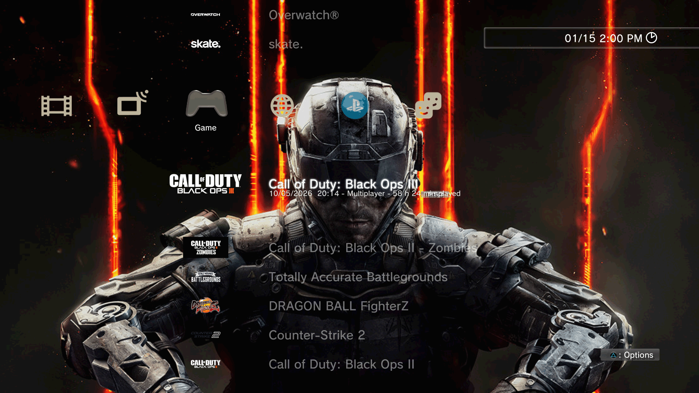
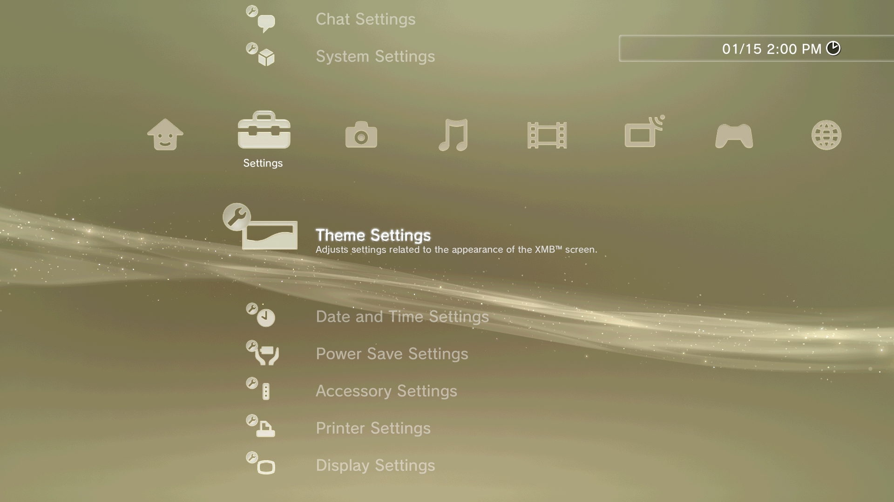
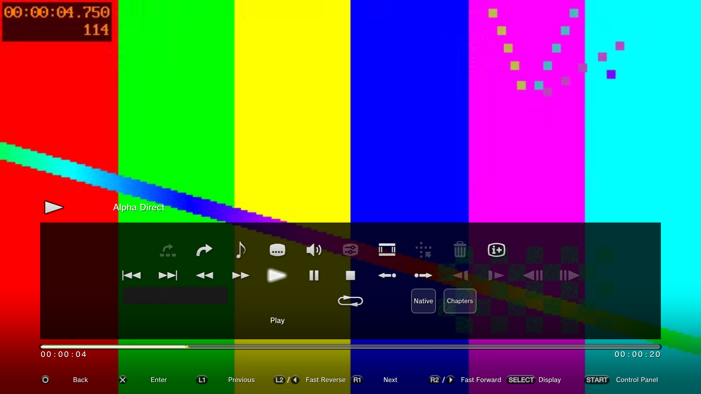
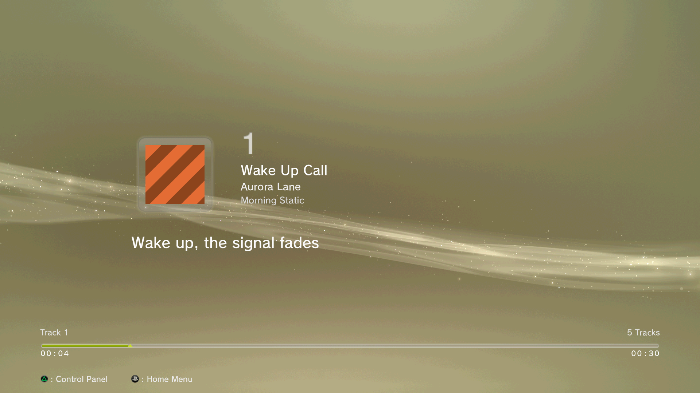
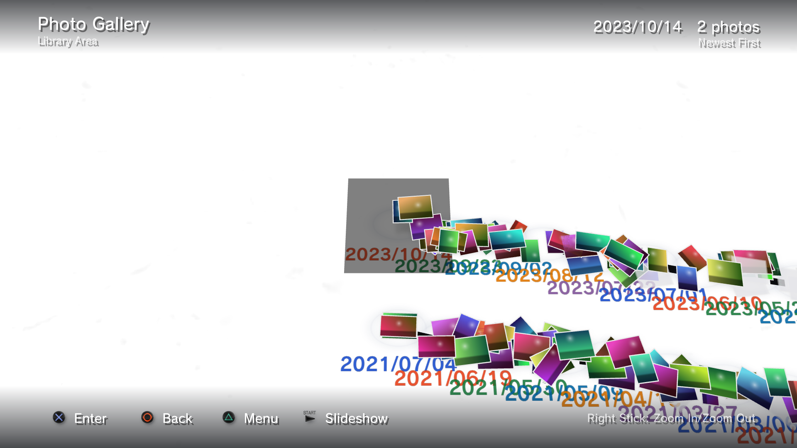
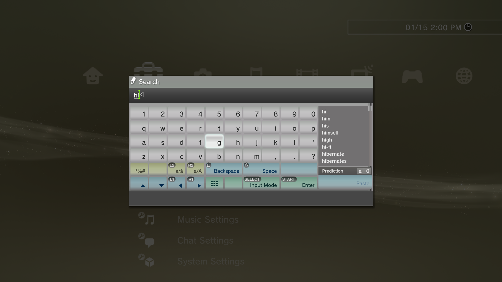
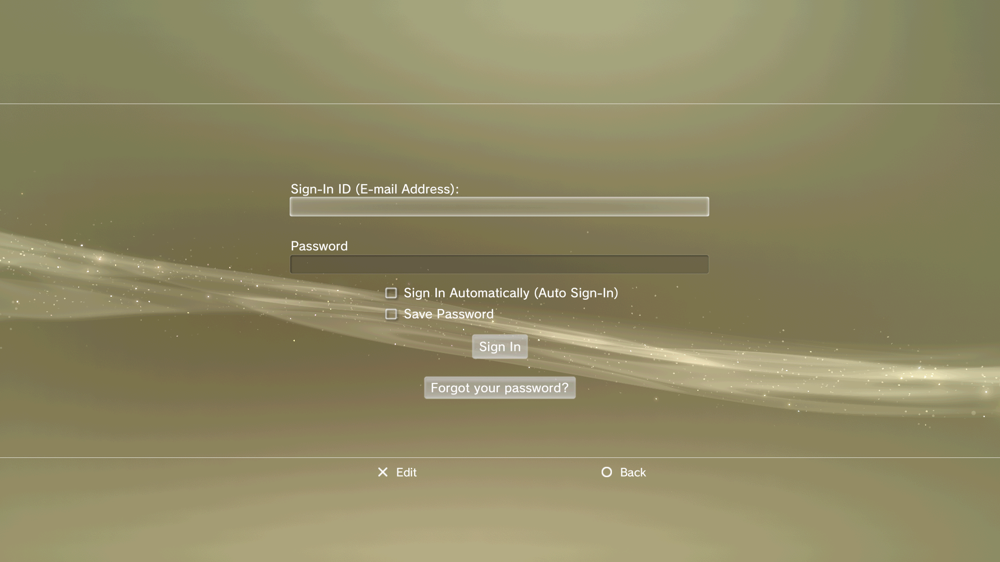
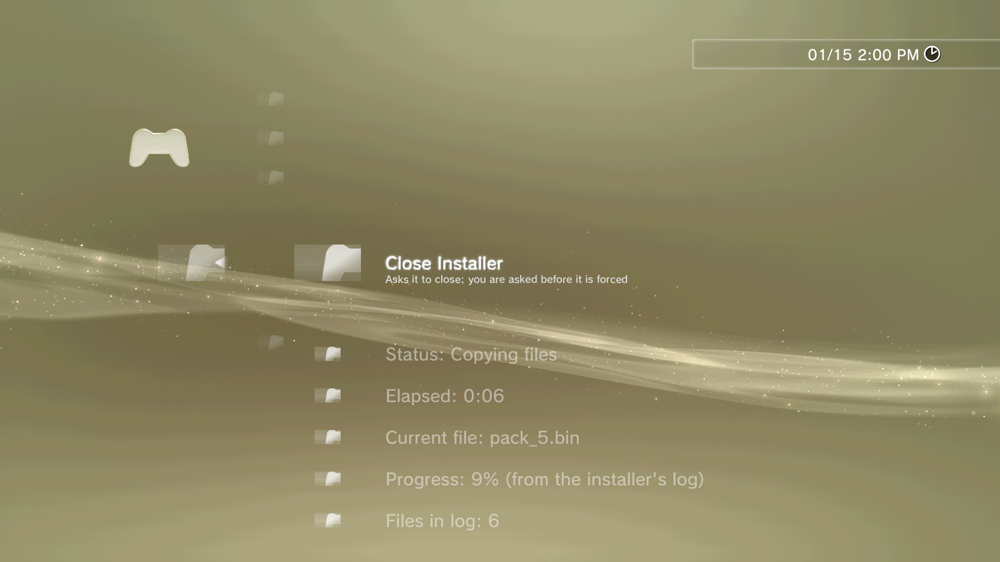
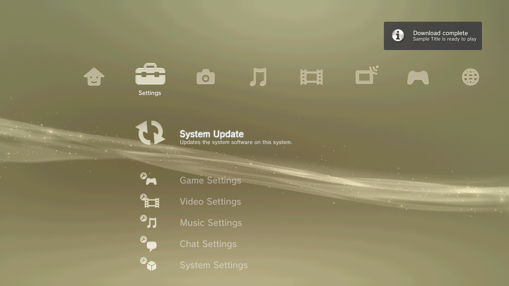

# XMB-Rewritten: a native PS3 XMB for Windows



A native Windows recreation of the PlayStation 3 **4.93 XMB**, built as a living-room PC (HTPC) front end. It is a C++20 / Qt 6 program that draws the console's own interface from the firmware's assets, which it reads from **your own copy** of the PS3 system software, and reproduces its look, motion, sounds and navigation. It is **not affiliated with Sony**, and **no Sony firmware or assets are in this repository**.

It is not an emulator. Nothing here runs PS3 code. The XMB is a from-scratch renderer and set of services (Steam, Jellyfin, media players and so on) wearing the console's presentation.

One CMake project builds two programs:

| Program | What it is | Docs |
|---|---|---|
| `re-ps3-native.exe` | The XMB: category bar, item columns, pages, options menus, dialogs, settings, media players, the on-screen keyboard, the system menu, themes and the cold-boot intro | [native-xmb/README.md](native-xmb/README.md), [INSTALL.md](native-xmb/INSTALL.md) |
| `xmb-manager.exe` | A companion that detects emulators and imports ROMs, ISOs and game folders as PS3-style packages for the Game column | [MANAGER.md](native-xmb/MANAGER.md) |

## Screenshots

Every image is a 1920x1080 framebuffer grab from the current build (v0.3.29), taken by the app's own `--script ... grab=` path with a pinned clock. Apart from the Game column, which shows a real Steam library read from disk, they use synthetic fixtures: a stand-in Jellyfin server with generated media, a generated photo library, a stand-in installer. How each was made is in [SCREENSHOTS.md](native-xmb/SCREENSHOTS.md).

| | |
|---|---|
|  |  |
| The Settings column | The video player's control matrix over a Jellyfin stream, with the Chapters slot |
|  |  |
| The music page with synced lyrics from Jellyfin | The 3D Photo Gallery over a generated 374-photo library |
|  |  |
| The on-screen keyboard with firmware dictionary predictions for "hi" | The PSN Sign In page. It never connects to PSN |
|  |  |
| The Installing panel, run against a synthetic installer | A notification toast |
|  | |
| The cold-boot wordmark stage | |

The screenshots show the firmware's icons, fonts and artwork, because that is what the XMB draws.

## What it does

Each line below is something the code does and the audits record. Where a feature has only been exercised against test fixtures or stand-ins, it says so; those are not the same as a run against the real service or installer.

### The shell

- **XMB columns** for Users, Settings, Photo, Music, Video, TV/Video Services, Game, Network, PSN and Friends, with a page stack that restores your selection, the Triangle options menu, message boxes, settings pages, the system menu and themes (`.p3t`).
- **Cold boot** with the Sony Computer Entertainment wordmark stage, the photosensitive-epilepsy notice. `XMB_BOOT_WORDMARK=0` keeps the earlier boot. Kiosk mode skips the intro unless you ask for it ([KIOSK-INTRO.md](native-xmb/audit/KIOSK-INTRO.md)).
- **Notifications and toasts** drawn from the firmware's own plaque and glyphs, with a message line in the info bar ([NOTIFICATIONS.md](native-xmb/audit/NOTIFICATIONS.md)).
- **On-screen keyboard** following the console's layout and its pad bindings (L1/R1 caret, L2/R2 pages, accent pages), with a Prediction column read from the firmware's own Zi8 dictionaries. It reads 17 of the alphabetic dictionary files (English US/UK, French, Spanish, Portuguese, German, Italian, Dutch, Danish, Swedish, Finnish, Norwegian, Polish and Russian); other languages fall back to English. You can pick a candidate and commit it, and paste with `Ctrl+V` or the Paste key ([OSK-FIRMWARE.md](native-xmb/audit/OSK-FIRMWARE.md)).
- **Display scaling:** the 1920x1080 design is scaled to any window size and Windows display scale ([HIGH-DPI.md](native-xmb/audit/HIGH-DPI.md)).
- **Input:** keyboard, XInput pads (Guide is the PS button), DualShock 3/4 and DualSense over HID, IR and Bluetooth remotes and media keys.

### Games

- **Steam library** in the Game column, read from the installed client's files: titles with **PS3-style transparent logo tiles** instead of boxed headers, collections, store, downloads, accounts and Quit Game. The **focused row shows a "PS3" badge**, and the focused game's artwork becomes the backdrop. `XMB_PS3_LOGO_TILES=0` and `XMB_GAME_BADGE=0` turn these off.
- **Launching a game** fades the XMB to black over the game-boot logo, starts the game behind black, then fades into it ([GAME-LAUNCH-FADE.md](native-xmb/audit/GAME-LAUNCH-FADE.md)). It is tested end to end against a stand-in game, and the timings are design choices, not recovered firmware values.
- **The in-game XMB** opens over the title's last good frame, and over the live game for borderless and windowed titles. It is not yet verified on real games (see the known gaps).
- **Pending Installers** keeps downloaded repacks that need a setup program. **Install (show installer)** runs the installer in its own visible window and opens an **Installing panel** with elapsed time, the log's current step, the destination size and a polite-then-confirmed close. It is verified against a synthetic installer only. Real DODI and FitGirl installers have not been run through it ([packaging/README.md](native-xmb/packaging/README.md)).
- **Release sources and Hydra:** the Download Games hub browses Hydra's source catalogue and imported JSON sources, with an optional FlareSolverr fallback for feeds behind bot protection and Real-Debrid for downloads. This is tested against fixtures and stand-in servers. Real FlareSolverr behaviour has not been observed ([JSON-SOURCE-CATALOG](native-xmb/audit/JSON-SOURCE-CATALOG-2026-11-19.md)).
- **XMB Manager** imports ROMs, ISOs and PS3 game folders as packages with emulator profiles ([MANAGER.md](native-xmb/MANAGER.md)). An encrypted retail `.pkg` is refused with an explanation.

### Media

- **Jellyfin** is set up from inside the XMB. Libraries, Continue Watching, Next Up, favourites and search; direct play and HLS transcodes; subtitles and audio-track choice; chapters; progress reporting and resume; and a Music-column entry with artists, albums, playlists, songs and synced lyrics. The video player follows the console's control matrix, with a Native Extras panel. It has been run against a stand-in server in this repository, not against a range of real Jellyfin installs ([JELLYFIN-PLAYER.md](native-xmb/audit/JELLYFIN-PLAYER.md)).
- **Seerr** (TV/Video Services): search, request and track media requests, with the key kept in a Windows DPAPI record. Optional SABnzbd controls appear in Download Management ([SEERR.md](native-xmb/audit/SEERR.md)).
- **Local media:** video with sidecar subtitles and resume, a music player with a visualizer, photos, playlists, and Continue Watching. The **Photo Gallery** is a native 3D recreation of the console's library area, with piles by day, a grid per pile and a hand-off to the photo viewer ([PHOTO-GALLERY.md](native-xmb/audit/PHOTO-GALLERY.md)).
- **Also:** Spotify, DLNA / UPnP discovery and RAWG artwork.

### Network, PSN and friends

- **PSN pages in the older firmware's look**, with no PSN connection. Sign In, Account Management and its sub-pages exist as pages; each says that it needs a PlayStation Network connection this program does not make, and nothing typed into them is sent or kept ([PSN-PAGES.md](native-xmb/audit/PSN-PAGES.md)).
- **Friends column** in the console's layout, listing a person only when a real source lists them. **Discord** friends need your own Discord application and Discord's approval of the `relationships.read` scope, so sign-in may fail until Discord grants it ([DISCORD.md](native-xmb/audit/DISCORD.md), [FRIENDS-COLUMN.md](native-xmb/audit/FRIENDS-COLUMN.md)). Rows with no presence data draw no status dot.
- **Home and network:** Tailscale, Wake on LAN, Home Assistant and weather, each as a native page.

### Living-room operation

- **Kiosk mode, watchdog and start at sign-in:** a frameless full-screen run on the chosen display, restarted after a crash, with a safe mode for repeated crashes ([SAFE-MODE.md](native-xmb/audit/SAFE-MODE.md)).
- **System:** Restart, Sleep and Shut Down, audio output switching, a read-only System Check and user management.
- **Updater:** the app checks GitHub Releases, downloads the release zip, verifies its SHA-256 and swaps the install folder.

## Requirements

- Windows 10 or 11 (x64), a GPU and driver with OpenGL 3.3.
- **Your own PS3 4.93 system software (`dev_flash`).** This repository ships none. The installer and the first-run setup can download Sony's official package for you, you can point at a `dev_flash` you already have (for example from your own RPCS3 install), or run `re-ps3-native.exe --firmware-install <folder>` yourself.
- Optional: the Steam client (Game column), a Jellyfin or Seerr server, and the Visual C++ 2015-2022 x64 redistributable if you run the zip.

## Install

Releases are on the [GitHub Releases page](https://github.com/ajgreenboy/XMB-Rewritten/releases). Each release has:

| File | Use |
|---|---|
| `re-ps3-setup.exe` | The per-user installer. It needs no administrator rights, offers to download the firmware, asks which display the TV is, and can set up start at sign-in. It is not code-signed, so Windows SmartScreen may warn. |
| `re-ps3.zip` | The portable folder. Unzip it, write `xmb-config.json` and run `run-kiosk.ps1`. |
| Updater | Once installed, the app updates itself from the same releases. |

Details, the command line and the data folder layout are in [INSTALL.md](native-xmb/INSTALL.md) and [packaging/README.md](native-xmb/packaging/README.md).

## Configure

| What | Where |
|---|---|
| Paths, display, kiosk intro | `xmb-config.json` ([example](native-xmb/packaging/xmb-config.example.json), [packaging/README.md](native-xmb/packaging/README.md)) |
| Jellyfin | TV/Video Services, then Jellyfin ([JELLYFIN-SETUP.md](native-xmb/audit/JELLYFIN-SETUP.md)) |
| Seerr | TV/Video Services, then Seerr ([SEERR.md](native-xmb/audit/SEERR.md)) |
| Steam | Nothing; it reads the installed client ([STEAM-INTEGRATION.md](native-xmb/audit/STEAM-INTEGRATION.md)) |
| Spotify, DLNA, Wake on LAN, Home Assistant, weather, Discord | A small json file each in the data folder ([native-xmb/README.md](native-xmb/README.md), [INSTALL.md](native-xmb/INSTALL.md)) |
| Emulators and imported games | [MANAGER.md](native-xmb/MANAGER.md) |

When a Steam game is in front and Steam Input is on for your controller, Steam can take the Guide button. If a tap on Guide opens Steam instead of the XMB, turn off Steam Input for that controller type.

## Build from source

You need Windows 10 or 11, Visual Studio 2022 with the C++ workload, Qt 6 (MSVC kit, 6.8 or newer) and a local `dev_flash` to run it.

```powershell
& .\native-xmb\build.ps1                 # builds both programs into out\integration
& .\run-native-xmb.ps1                   # launches the XMB with your dev_flash
```

`native-xmb/packaging/build-package.ps1` produces the self-contained folder that the release workflow zips and wraps in the installer. The full build, command line and `--script` language are in [INSTALL.md](native-xmb/INSTALL.md).

## Tests and the visual gate

- Unit tests are separate CMake targets, each registered in [`tests.yml`](.github/workflows/tests.yml). `bun work/ci-guard.ts` checks that the targets, the `tests/` folder and the workflow agree.
- `bun work/ab-layers.ts --all --exe <exe>` is the render gate: six content-neutral layers and 28 named states, compared against stored baselines. The baselines live in `out/native-reference/`, which is untracked and absent on a fresh clone, so on a clone you create your own with `--save-reference` ([native-xmb/README.md](native-xmb/README.md)). The named states are self-baselines of this renderer, not measurements of the console.
- `powershell -NoProfile -ExecutionPolicy Bypass -File work\release-check.ps1 -SkipBuild` runs the release hygiene scans (credentials, firmware data, dumps, document links and stale commit ids) without the build.
- `bun work/readme-shots.ts` regenerates the screenshots above from synthetic fixtures.

How close the renderer is to the console, surface by surface, is in [FIDELITY-VERDICT.md](native-xmb/audit/FIDELITY-VERDICT.md).

## Status and known gaps

Version **0.3.29**. It builds cleanly and its own checks pass. Real-hardware testing on a living-room PC is still in progress, so treat anything that depends on a physical TV, remote or game as unverified until you try it ([RELEASE-CHECKLIST.md](native-xmb/audit/RELEASE-CHECKLIST.md)).

- The in-game system menu is a translucent overlay on the live game for borderless and windowed titles. It falls back to a frozen frame for exclusive fullscreen, or when the overlay cannot start (`XMB_INGAME_LIVE=0` forces the frozen frame). 4K timing, exclusive fullscreen, Steam Input and anti-cheat tolerance are listed in [INGAME-OVERLAY-DESIGN.md](native-xmb/audit/INGAME-OVERLAY-DESIGN.md).
- Real DODI and FitGirl installers, and a real FlareSolverr, have not been exercised.
- A DualSense is read directly over HID. Steam Input for PlayStation controllers can hide it from the XMB while a Steam game runs.
- PSN is not connected. Rows that need it say so.
- Differences from the console that are recorded and not yet fixed are in the parity audits ([audit index](native-xmb/audit/README.md)).

## Repository layout

| Path | Contents |
|---|---|
| `native-xmb/` | The application: `src/`, `manager/`, `packaging/`, `updater/`, `tests/` and the documents |
| `native-xmb/audit/` | Design notes, firmware audits, parity sweeps and verification notes |
| `native-xmb/screenshots/` | Screenshots used by the documents |
| `work/` | Verification tools: the render gate, the parity corpus, the release check and the screenshot script |
| `run-native-xmb.ps1` | The launcher for a development build |
| `out/`, `dist/` | Local build and capture output (not tracked) |

More documentation: the [application README](native-xmb/README.md), the [handoff](native-xmb/HANDOFF-2026-11-25.md), the [audit index](native-xmb/audit/README.md), the [HTPC run guide](native-xmb/audit/HTPC-RUN-GUIDE.md) and the [third-party notices](native-xmb/THIRD-PARTY.md).

## Legal and firmware

The XMB draws the console's interface from PS3 system software that **you** supply. This repository contains source, documents and screenshots only. No firmware, extracted or decrypted assets, analysis databases, console identities, API keys or build outputs are in it. Screenshots show firmware-drawn UI elements because that is what the program renders.

The firmware downloader fetches Sony's own update file and checks every entry. It decrypts with the publicly known keys that RPCS3 also ships, committed in `native-xmb/src/firmware_keys.inc`. That is a deliberate decision recorded in [FIRMWARE-FETCH.md](native-xmb/audit/FIRMWARE-FETCH.md), not legal advice. Consider the law where you live and Sony's terms.

Online services never fabricate results. Nothing signs in, buys, earns a trophy or sends a message on its own. No licence for redistribution is assigned by this repository. "PlayStation", "PS3" and related marks belong to Sony Interactive Entertainment; game titles and artwork in screenshots belong to their owners. See the third-party notices for components.
